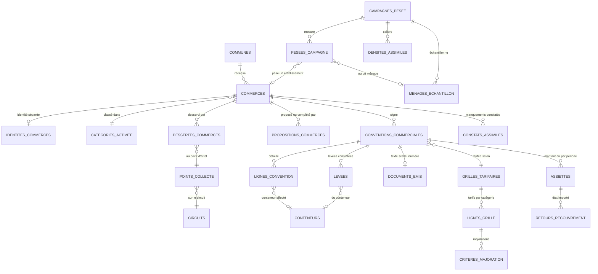

# SIIPI — Jalon G : déchets assimilés et conventions de propreté

**FNCT · 4 novembre 2026 · ouvert par Nacer · statut : spécification v1.1 (décisions du 4 novembre intégrées) ; G1 développé en v0.15.90 (migration 098), G2a (établissements) en v0.15.91 (migration 099), G2b (import TCL et open data) en v0.15.94 (migration 102) ; G3 à G7 restent à coder**

Le jalon G fait de la convention de propreté un dossier numérique complet :
**établissement → convention annuelle → conteneurs et desserte → levées constatées → assiette → export vers le système financier → suivi des manquements.**

Il s'appuie sur la note conceptuelle de Nacer (4 novembre 2026), sur le guide WaCT d'ONU-Habitat (étape 3, annexe 5) et sur les décisions G-1 à G-4 ci-dessous. Toutes les tables et fonctions citées comme existantes ont été relues dans une base reconstruite à partir des 96 migrations du dépôt.

---

## 0. Décisions de Nacer (4 novembre 2026)

| # | Décision |
|---|---|
| **G-1 Facturation** | **La ligne rouge n° 5 est gardée.** SIIPI calcule l'**assiette** (le montant dû par convention et par période, avec son détail) et l'**exporte** vers le système financier de la commune. L'état du recouvrement est **réimporté en lecture seule** pour suivre les impayés. Aucune facture, aucun encaissement, aucune relance de paiement dans SIIPI. |
| **G-2 Mesure** | Deux flux **découplés**. (a) **Les circuits** (quotidien) : on y enregistre les **levées** des établissements situés sur le tracé. (b) **La campagne de pesée** (ponctuelle, Kobo, enquêteur dédié) : elle pèse un échantillon d'établissements en porte-à-porte, **sans camion** — un camion ne s'arrête jamais dans un circuit pour peser un établissement. Un établissement **sans circuit** : forfait ou point d'apport volontaire, **au choix de la commune**. |
| **G-3 Identification** | Par **matricule fiscal**, ou par **CIN** pour une personne physique sans matricule. |
| **G-4 Recensement** | Trois sources, dans cet ordre : **import de la liste TCL** (base de départ), **recensement Kobo** (vérification et complément, en propositions adoptées par la commune), **saisie manuelle** (exceptions). **Un établissement recensé n'est jamais supprimé** : il est « fermé », avec sa date de fermeture. |

## 0bis. Ce que la spécification ajuste dans les propositions, et pourquoi

Ces ajustements gardent l'intention des décisions. Chacun est à confirmer par Nacer (§ 9).

| Proposé | Ajusté | Raison |
|---|---|---|
| `commerces.est_dans_circuit` (booléen) + `circuit_id` | Une table **`dessertes_commerces`**, datée : établissement → point d'arrêt d'un circuit, du … au … | Un booléen et un identifiant disent deux fois la même chose et finissent par se contredire. Surtout, la desserte **change** (circuit retracé, contrat échu) : sans dates, une levée de mars serait rattachée au circuit de juin. « Est desservi » se **calcule** (desserte en cours à la date). |
| `densite_calibree` dans `grilles_tarifaires` | Une table **`densites_assimiles`**, à part de la grille | La grille vient d'un **arrêté** approuvé par la tutelle ; la densité vient d'une **mesure**, recalibrée après chaque campagne. Les mettre dans la même ligne obligerait à « modifier l'arrêté » à chaque campagne. |
| Réel = levées × densité calibrée | **Assiette réelle = levées constatées × tarif par levée.** Le tonnage (levées × densité) sert aux **indicateurs**, en fourchette, jamais à l'assiette — sauf pesée réelle de l'établissement | Un montant calculé sur une densité est un montant **estimé** : un commerçant peut le contester, et la règle d'or 1.1 interdit de présenter une estimation comme une mesure. Le **nombre de levées**, lui, est **constaté** : c'est une assiette défendable. Le tarif par tonne ne s'applique qu'à un poids réellement pesé. |
| Dédoublonnage : même matricule **ou** GPS < 5 m → mise à jour | Même matricule → **rattachement automatique**. GPS < 5 m sans matricule commun → **« à vérifier »**, jamais automatique | Deux boutiques voisines d'une même rue sont souvent à moins de 5 m, et la précision d'un téléphone est de 5 à 15 m. Une fusion automatique au GPS écraserait un commerce par son voisin. |
| `nb_levees_equivalentes` dans la pesée | La pesée enregistre ce qui est **observé** : poids, durée de production couverte, contenant et taux de remplissage. Les équivalences se **calculent** | Une « équivalence » saisie à la main est une opinion ; calculée à partir du contenant, elle est vérifiable. |
| CIN dans la fiche de l'établissement | CIN **jamais en clair** : empreinte HMAC dans une **table d'identité séparée**, comme pour les pré-collecteurs (lot 16.1) | La règle de SIIPI : le CIN en clair n'est jamais écrit ni journalisé. La garde `hebergement_pii_accredite` s'applique : **tant qu'elle est fausse, aucune identité nominative n'entre**, et l'établissement se recense par son matricule ou « identifiant à compléter ». |

---

## 1. Le cadre légal, tenu comme une donnée datée

La règle de SIIPI (v0.15.83) s'applique ici : **toute règle légale est un paramètre national daté, jamais du code.**

- La **base légale** des conventions est une liste nationale datée (`elements_listes_nationales`, nouvelle liste `base_legale_assimiles`). Chaque texte y porte : son intitulé FR/AR, sa référence de publication (JORT), sa **date d'application** (`date_effet`) distincte de sa publication, et sa date de fin quand il est abrogé (`date_fin`, `reference_fin`).
- Exemple d'usage : le **décret-loi n° 4 du 30 septembre 2026** (JORT n° 96) entre dans la liste avec une date d'application **vide** tant que les résultats des prochaines élections municipales ne sont pas proclamés (article 136). La loi organique n° 2018-29 du 9 mai 2018 qu'il abroge (article 139) reçoit sa date de fin le même jour. Les dates et le texte applicable dans l'intervalle sont confirmés par la FNCT, pas déduits par SIIPI.
- **Une convention fige sa base légale à son émission** : le texte de la convention est un document scellé (`documents_emis`, contenu figé), qui recopie les références en vigueur ce jour-là. Une convention signée sous l'ancien texte ne se rattache jamais rétroactivement au nouveau.
- Les références restent à vérifier article par article avant d'entrer en base (article 25 de la loi n° 96-41, article du Code de la fiscalité locale sur la redevance des déchets d'établissements). SIIPI n'invente aucune référence.

## 2. Le modèle conceptuel

`communes`, `circuits`, `points_collecte`, `conteneurs`, `documents_emis` et `fichiers` existent. `commerces` et `conventions_commerciales` existent et sont **étendues**. Les autres sont nouvelles. Toutes portent `commune_id`, `ENABLE` et `FORCE ROW LEVEL SECURITY`, la suppression logique (sauf les journaux en ajout seul) et la provenance `reel` / `simule`.

## 3. Les entités

### 3.1 Établissements

**`commerces`** (étendue ; le nom de table est gardé, l'écran dit « Établissements »)

| Colonne | Règle |
|---|---|
| `raison_sociale` (actuel `nom`) | Obligatoire |
| `categorie_activite` | Code de la liste nationale datée `categories_activite_assimiles` (café, restaurant, hôtel, supérette, boulangerie, marché, bureau, école, atelier…). Obligatoire |
| `matricule_fiscal` | Facultatif ; **unique par commune** quand il est présent ; format contrôlé |
| `identifiant_statut` | `matricule` · `cin` (empreinte dans `identites_commerces`) · `a_completer` |
| `adresse`, `secteur` (`zone_id`), `geom` (POINT 4326, facultatif), `precision_m` | Position seulement si elle a été relevée ; jamais déduite de l'adresse |
| `unite_echelle`, `valeur_echelle` | L'unité du WaCT selon la catégorie : chambres ou lits (hôtel), chaises ou tables (restaurant), étals (marché), m² (magasin, bureau), élèves ou employés (école, administration) |
| `surface_m2` | Facultatif ; sert aux majorations quand la grille le prévoit |
| `statut` | `actif` · `ferme` (avec `ferme_le` et `motif`) · `a_verifier` (avec `motif`). **Jamais supprimé** |
| `source_creation` | `import_tcl` · `kobo` · `saisie` |
| `produit_dangereux` | Booléen déclaratif : signale un flux à orienter vers sa filière, **jamais couvert par la convention** |

**`identites_commerces`** (nouvelle, sur le modèle de `donnees_personnelles_barbechas`)
Nom du responsable, téléphone, et `empreinte_cin` (HMAC-SHA256 sous `SIIPI_SECRET_IDENTITES`). Lue par l'administrateur de la commune seul, chaque lecture journalisée ; écriture refusée tant que `hebergement_pii_accredite` et le récépissé INPDP manquent. Hors du journal d'audit des écritures.

**`dessertes_commerces`** (nouvelle) : `commerce_id`, `point_id` (un point d'arrêt d'un circuit), `date_debut`, `date_fin`. Une desserte en cours au plus par établissement. Un circuit échu ferme ses dessertes.

### 3.2 Recensement

**Import TCL** (développé en v0.15.94 : `POST /etablissements/import/colonnes` puis `POST /etablissements/import` ; décision du 10/11/2026 : le fichier de la commune est importé **tel qu'il est**, par une correspondance des colonnes proposée, corrigée et gardée par commune et par type de fichier ; un jeu open data porte sa licence et son producteur) — Excel ou CSV, en deux temps comme les imports du parc et des contacts : un **aperçu** ligne par ligne (à créer, à rattacher, inchangé, à vérifier, erreur avec sa raison), puis la validation des seules lignes valides, en une transaction. Obligatoires : raison sociale et activité ; matricule fiscal s'il est présent. Une activité du fichier qui ne correspond à aucune catégorie est proposée à la correspondance, jamais devinée.

**`propositions_commerces`** (nouvelle, sur le modèle de `points_suggeres`) : chaque réponse Kobo de recensement, avec sa clé de soumission (une soumission reçue deux fois ne crée rien), ses champs, sa position et sa précision, sa photo de façade, et le **résultat du rapprochement** :

| Rapprochement | Ce que voit la commune |
|---|---|
| Même matricule fiscal qu'un établissement existant | « Complète l'établissement X » : à l'adoption, seules les cases vides de l'existant sont remplies ; une valeur différente est montrée, jamais écrasée en silence |
| Position à moins de 5 m d'un établissement existant, sans matricule commun | « À vérifier : peut-être X, à 3,2 m » — la commune rattache ou crée |
| Aucun rapprochement | « Nouvel établissement » |

La commune **adopte** ou **écarte** (avec motif) ; une proposition écartée reste en base.

**Saisie manuelle** : le formulaire unique par le bouton « + Ajouter », avec le même contrôle de doublon.

### 3.3 Grille tarifaire et densités

**`grilles_tarifaires`** (nouvelle) : une par commune et par arrêté — référence et date de l'arrêté municipal, référence de la délibération, **date d'approbation de la tutelle**, date d'effet, date de fin. **Une grille n'est applicable qu'approuvée** : sans date d'approbation, elle reste un projet et ne produit aucune assiette.

**`lignes_grille`** : par catégorie d'activité, le **mode** (`forfait_annuel`, `forfait_mensuel`, `reel_levee`, `reel_poids`), le tarif de base et son unité (DT par an, par mois, par levée, par tonne).

**`criteres_majoration`** : des règles paramétrables, sans code — un critère (`surface_m2`, `frequence_hebdo`, `capacite_conteneur_l`, `nb_points_vente`), une tranche, un effet (`coefficient` multiplicatif ou `ajout` fixe). L'ordre d'application est fixé par la grille.

**`densites_assimiles`** (nouvelle, à part de la grille) : par commune (ou nationale si vide), catégorie d'activité et contenant, une densité **minimale et maximale** (kg par levée ou kg/m³), sa **source** (`campagne` avec son identifiant, `tadaeem`, `defaut`), sa date d'effet ; retirée avec motif, jamais réécrite — même discipline que `densites_reference` (17.2).

### 3.4 Convention

**`conventions_commerciales`** (étendue)

| Colonne | Règle |
|---|---|
| `exercice`, `date_debut`, `date_fin` | Annuelle ; `convention_precedente_id` pour un renouvellement |
| `mode_tarification` | Celui de la ligne de grille, fixé à la signature |
| `grille_id` | La grille approuvée en vigueur à la date de début |
| `statut` | `brouillon` → `instruite` → `signee` → `active` → `expiree` ou `resiliee` (avec motif). Une convention signée ne se modifie plus : un changement est un avenant (nouvelle version) |
| `document_id` | Le document scellé `convention_proprete` (préfixe `CV`), numéro continu par commune et exercice, contenu figé avec la base légale du jour, PDF bilingue |
| `montant_annuel_prevu` | Calculé pour un forfait, à la signature, avec son détail |

**`lignes_convention`** : flux (liste nationale des **déchets assimilés** ; un flux dangereux est **refusé**), conteneur affecté, fréquence hebdomadaire, quantité estimée.

La convention garde aussi le lien avec l'indicateur M2-2 existant : une convention active compte pour l'indicateur, une seule fois, sans table parallèle. **Un établissement « à vérifier » sous convention reste compté** (décision de la FNCT du 10/11/2026 : le statut porte sur l'identité, pas sur la convention), et le détail de l'indicateur dit « N sous convention, dont M à vérifier » (v0.15.92, migration 100).

### 3.5 Levées et campagne de pesée — deux flux découplés

**`levees`** (nouvelle) : une levée constatée d'un établissement desservi — convention, conteneur, date et heure (heure de Tunis, prise sur l'appareil), circuit et voyage, **source** (`circuit_portail`, `kobo`, et plus tard `capteur` par le connecteur générique), clé d'envoi. Une levée **proposée** depuis le terrain est **validée par la commune** avant de compter dans une assiette (règle « proposer, puis adopter »). Un établissement sans desserte en cours **ne reçoit aucune levée** : c'est refusé, avec le motif.

**`campagnes_pesee`** (nouvelle, **générique**) : une campagne de pesée — commune, **objet** (`etablissements` ou `menages`), période, protocole, statut. **Aucun lien avec un circuit ni un engin.** Une même table sert aux deux objets, pour qu'une future pesée ménagère n'ait pas à créer la sienne (décision du 4 novembre).

**`pesees_campagne`** (nouvelle) : une mesure de l'enquêteur — **soit** un établissement, **soit** un ménage de l'échantillon (exactement l'un des deux, selon l'objet de la campagne), date, **jour de la campagne**, **poids en kg**, **durée de production couverte** (en jours ou en heures), contenant pesé et son volume, taux de remplissage observé, clé de soumission Kobo, photo facultative. Aucun nom d'enquêteur.

**`menages_echantillon`** (nouvelle) : un ménage pesé, **sans nom ni adresse** — identifiant pseudonyme de la campagne, secteur, **nombre d'habitants**, **tranche de revenu** (`bas`, `moyen`, `eleve`). Pour une campagne de ménages, le **premier jour est exclu** des calculs (déchets accumulés avant la campagne, règle du WaCT) : la production par habitant est la somme des jours 2 à 8 divisée par 7 × le nombre d'habitants, par tranche de revenu. **Le jalon G pose le modèle et ses refus ; l'écran et le formulaire Kobo des ménages viennent quand une commune engage une telle campagne.**

Une campagne close **calcule** (jamais saisi à la main) : par catégorie d'activité, la production en **kg par jour et par unité d'échelle** (le ratio WaCT) et la densité en **kg par levée**, avec la taille de l'échantillon. Elle propose une ligne de `densites_assimiles`, que la commune adopte. Sous un seuil d'échantillon fixé par la FNCT, la campagne ne propose rien.

### 3.6 Assiette et export

**`assiettes`** (nouvelle) : par convention et par période (mois, trimestre ou année selon la convention) — montant dû et **son détail** (ligne de grille, majorations appliquées, nombre de levées validées, poids pesé s'il y en a), version du calcul, statut (`calculee`, `exportee`, `annulee` avec motif). Une assiette exportée ne se recalcule pas : une correction est une assiette rectificative.

| Mode | Calcul | Nature |
|---|---|---|
| `forfait_annuel` | Montant annuel de la convention, réparti selon la périodicité convenue | Contractuel |
| `forfait_mensuel` | Montant mensuel, quelles que soient les collectes | Contractuel |
| `reel_levee` | Levées **validées** de la période × tarif par levée (× majorations) | **Mesuré** |
| `reel_poids` | Poids **réellement pesé** de l'établissement × tarif par tonne | **Mesuré**, seulement si une pesée embarquée existe |

**Le tonnage estimé** (levées × densité, en fourchette) **n'entre jamais dans une assiette**, pas plus que le gisement estimé et le **proxy WaCT de 30 %** (§ 5) : ils servent à l'estimation globale et aux indicateurs, **jamais à la facturation**.

**Export** : un fichier par commune et par période, au format attendu par le système financier (ADEP ou INSAF : **format à obtenir de la commune ou du receveur**), avec le numéro de convention, l'établissement, la période, le montant et la référence de l'arrêté.

**`retours_recouvrement`** (nouvelle, en lecture seule) : l'état renvoyé par le système financier (payé, partiellement, impayé, date), importé tel quel. Il sert au suivi des impayés et aux alertes ; SIIPI ne le modifie pas.

### 3.7 Manquements

**`constats_assimiles`** (nouvelle) : dépôt hors conteneur, conteneur non conforme, débordement, tri non respecté, absence de convention — établissement, date, type, description, photo, statut. **Au nom de la commune, jamais d'un agent.** Une éventuelle sanction est une **décision de la commune**, enregistrée par sa référence (arrêté, procès-verbal) : SIIPI ne calcule ni n'applique aucune amende.

## 4. Les deux formulaires Kobo, distincts

| Formulaire | Objet | Arrive dans |
|---|---|---|
| **Recensement** | Identification, catégorie, unité d'échelle et sa valeur, production déclarée en kg/jour (WaCT, annexe 5, Q1), collecteur actuel (Q2), position, photo de la façade | `propositions_commerces` |
| **Campagne de pesée** | Établissement visé (liste exportée de SIIPI), poids, durée couverte, contenant, remplissage, photo | `pesees_campagne` |

Les champs exacts seront donnés au conseiller SIG plus tard, sur la base des colonnes ci-dessus. Les règles du modèle conceptuel de l'interopérabilité s'appliquent (clé de soumission, `deviceid` désactivé, heure de l'appareil, ordre latitude-longitude).

## 5. Indicateurs et tableau de bord de la commune

- Établissements recensés, conventionnés, avec convention expirée ; taux de conventionnement **par catégorie** (dénominateur affiché).
- Assiettes calculées et exportées ; **impayés selon le dernier retour importé**, daté (jamais « 0 impayé » sans retour).
- Levées réalisées face aux levées prévues par la convention (fréquence) : un écart est un avis, pas une sanction.
- Tonnage des assimilés **estimé**, en fourchette, avec sa source de densité.
- **Gisement des assimilés de la commune** (production de tous les établissements, conventionnés ou non), selon les trois options du WaCT (étape 3), **la plus précise disponible l'emporte** et son nom est affiché :

| Option WaCT | Calcul dans SIIPI | Quand |
|---|---|---|
| 3. Échantillonnage direct | Somme, par catégorie, du nombre d'unités recensées × le ratio **kg/jour par unité** calculé par une campagne de pesée close | La catégorie a une campagne au-dessus du seuil d'échantillon |
| 2. Entretiens et données administratives | Somme des productions **déclarées** au recensement (kg/jour, annexe 5, Q1) ; à défaut, unités × ratio de référence national daté | Pas de campagne pour la catégorie |
| 1. Proxy | **W_assimilés = W_ménagers × 0,30 / 0,70**, soit 30 % du total des déchets municipaux, 70 % étant ménagers | Rien d'autre ; affiché « proxy WaCT », jamais comme une mesure |

  Pour le proxy, **W_ménagers** est le gisement ménager estimé (population retenue × production spécifique de la commune, paramètres du lot 17.1). Sans ces deux paramètres, le proxy n'est pas calculé : il est « non renseigné », jamais 0. Le proxy porte sur le gisement **généré**, pas sur le tonnage collecté ; il n'est jamais additionné à une pesée. Les catégories peuvent mêler les options : chaque ligne dit la sienne.
- Manquements constatés, par type et par mois.
- Alertes : convention arrivant à échéance (60 jours), grille sans approbation, établissement desservi sans convention, levées absentes au-delà de la fréquence prévue.

Ces chiffres suivent les règles des indicateurs : une donnée manquante n'est pas un zéro ; pas de classement d'établissements.

## 6. Hors du jalon G

- **Factures, paiements, relances, paiement en ligne** (ligne rouge n° 5).
- **Espace commerçant** : un nouveau type de compte ; pourra venir plus tard en consultation (sa convention, ses levées), sans paiement.
- **Capteurs sur les bacs** (IoT, hors TDR pour cette phase) : le modèle accepte une levée de source `capteur`, arrivant par un connecteur générique comme le GPS, le jour où ils existent.
- **Indicateur ODD 11.6.1** : intéressant au niveau national, mais il demande l'évaluation des installations de traitement (« ladder of control ») ; à instruire avec la FNCT et l'ANGeD.

## 7. Lots

| Lot | Contenu | Condition |
|---|---|---|
| **G1** | Listes nationales datées (catégories d'activité, flux assimilés avec le marqueur « dangereux », base légale) ; grilles tarifaires, lignes, majorations, approbation de la tutelle | — ; **développé en v0.15.90** (migration 098) |
| **G2** | Établissements étendus, statut et fermeture, import TCL avec aperçu et rapprochement ; identité séparée (inactive tant que la garde est fausse) | G1 |
| **G3** | Propositions Kobo de recensement, rapprochement, adoption | G2 ; formulaire du conseiller SIG |
| **G4** | Conventions : cycle de vie, document scellé `convention_proprete`, avenants, renouvellement, lien M2-2 | G1, G2 |
| **G5** | Dessertes, levées (proposées, validées), campagnes de pesée génériques (établissements ; modèle ménages avec ses refus) et densités calibrées | G4 |
| **G6** | Assiettes, export, import des retours de recouvrement | G4, G5 ; format ADEP / INSAF |
| **G7** | Manquements, tableau de bord, alertes | G4 |

Chaque lot suit le protocole de `CLAUDE.md` : une migration, une campagne qui commence par ce que la base refuse, un témoin de calcul indépendant pour les assiettes et les densités (comme `volumetrie_attendus.py`), `verifier:contrat` et toutes les campagnes au vert.

## 8. Ce que les campagnes refusent d'abord

- Une convention sur une grille non approuvée ; un flux dangereux dans une ligne de convention.
- Une levée pour un établissement sans desserte en cours, ou une levée rejouée avec la même clé.
- Une assiette `reel_poids` sans pesée réelle ; une assiette qui utiliserait une densité, un gisement estimé ou le proxy.
- Une pesée de campagne qui vise à la fois un établissement et un ménage, ou ni l'un ni l'autre ; un ménage d'échantillon avec un nom ou une adresse ; le jour 1 d'une campagne de ménages compté dans la production.
- Une modification d'une convention signée ou d'une assiette exportée.
- Un CIN en clair, n'importe où ; une identité écrite quand la garde est fausse.
- La suppression d'un établissement ; une fusion automatique au GPS.
- Une commune qui lit les établissements, conventions ou assiettes d'une autre.

## 9. À confirmer par Nacer

| Question | Proposition par défaut |
|---|---|
| Assiette réelle : par **levée** constatée, et la densité réservée aux indicateurs (§ 0bis) | Oui |
| Rapprochement GPS < 5 m : « à vérifier », jamais automatique | Oui |
| Desserte datée au lieu de `est_dans_circuit` + `circuit_id` | Oui |
| Densité à part de la grille | Oui |
| Qui propose une levée : le chef d'équipe (rôle `chef_equipe`, décision F-2) depuis Kobo, ou la commune au portail | Les deux ; la commune valide toujours |
| Approbation de la tutelle : sur l'arrêté tarifaire seulement, ou sur chaque convention | Sur l'arrêté seulement ; une convention l'applique |
| Seuil d'échantillon d'une campagne de pesée | 10 établissements par catégorie, réglable par la FNCT |
| Format d'export vers ADEP / INSAF | À obtenir de la commune pilote ou du receveur ; d'ici là, un CSV documenté |
